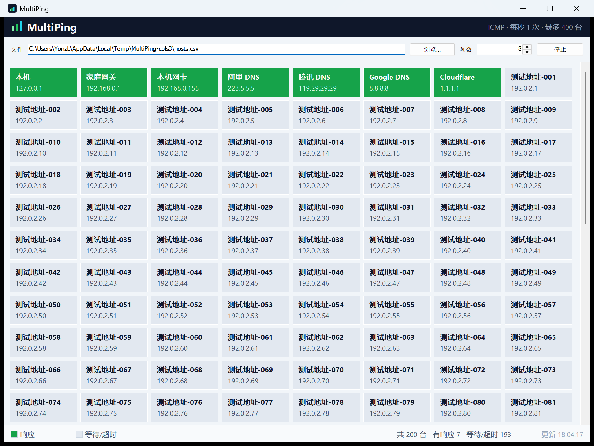

# MultiPing

MultiPing 是一个 Windows 原生多主机 ICMP 轮询工具，使用 Go 与
[walk](https://github.com/lxn/walk) 编写，直接调用 Windows `IcmpSendEcho`：
不需要管理员权限，也不会为每次探测创建 `ping.exe` 子进程。



## 目录结构

```text
MultiPing/
├── src/          Go 源码与测试（package main）
├── build/        构建输入：app.manifest、app.ico
├── resource/     运行时数据与文档图片：hosts.csv、shot.png
├── scripts/      构建脚本：build.ps1
├── dist/         构建输出（git 忽略）：MultiPing.exe、hosts.csv
├── go.mod / go.sum
└── README.md
```

## 功能

- 启动时自动加载 exe 同级的 `hosts.csv`，也可以点“浏览…”选择其他 CSV。
- 默认每行 8 台主机，可通过工具栏“列数”在 1–9 之间调整；按从左到右、从上到下的顺序排列。
  最多加载 400 台，超出部分忽略。
- 卡片宽度采用相对布局：当前列数始终填满窗口可用宽度，窗口变宽/变窄时自动伸缩；
  窗口最小宽度 720。
- 网格区域支持鼠标滚轮上下滚动；主机较多时也可拖动右侧滚动条。
- 卡片高度 50，文字只保留两行（名称、IP）。
- 每台主机独立计时，**每秒发送 1 次 ICMP Echo**；单次超时 1 秒。
- 每次收到响应，卡片变为绿色 `#16A34A` 并**保持到下一次探测结果**；
  下一次超时、停止探测或重新开始后尚未收到响应时，卡片恢复浅灰 `#E2E8F0`。
- 每张卡片只显示两行：主机显示名称、IP 地址。
- “开始 / 停止”按钮切换探测；停止时所有卡片统一为浅灰，当前主机列表保留；
  重新开始后所有卡片先清空结果，收到新的响应才变绿。
- 底部状态栏显示总数、当前有响应的主机数、跳过行数和更新时间；
  状态栏每 500 毫秒刷新一次。
- CSV 支持 UTF-8（带或不带 BOM）和 GB18030/GBK。

## hosts.csv 格式

```csv
hostName,hostIP
本机,127.0.0.1
家庭网关,192.168.0.1
核心交换机,192.168.1.1
```

- `hostName`：显示名称；为空时显示 IP。
- `hostIP`：IPv4 地址。
- 表头可以省略。少于两列或 IPv4 无效的行会被跳过，并在加载后给出提示。
- 自带的 `hosts.csv` 共有 200 行示例：本机、网关、网卡、公共 DNS，以及
  `测试地址-001` … `测试地址-193`（使用保留的 TEST-NET 网段 `192.0.2.x`，
  通常不可达，因此显示为灰色）。正式使用前请替换为实际地址。

## 编译

需要 Windows 和 **Go 1.21.13**。

> 兼容 Windows Server 2012 R2：Go 1.22 及更高版本的链接器会把 PE 的
> `MajorOperatingSystemVersion` / `MajorSubsystemVersion` 标成 `10.0`，
> Windows Server 2012 R2（6.3）会拒绝加载。本版本使用 Go 1.21.13 构建，
> PE 最低系统版本为 6.1，可在 Windows 7 SP1 / Server 2008 R2 及以上运行。

```powershell
# 如果 PATH 中的 go 高于 1.21，强制使用 1.21.13 工具链
$env:GOTOOLCHAIN = "go1.21.13"

go test ./src/...
rsrc -manifest build/app.manifest -ico build/app.ico -o src/rsrc.syso -arch amd64
New-Item -ItemType Directory -Force dist | Out-Null
go build -ldflags="-H windowsgui" -o dist/MultiPing.exe ./src
Copy-Item resource/hosts.csv dist/hosts.csv -Force
```

也可以直接运行：

```powershell
powershell -ExecutionPolicy Bypass -File scripts/build.ps1
```

`src/rsrc.syso` 包含应用清单（Common Controls v6、PerMonitorV2 DPI 感知）和
`build/app.ico`，后者同时作为窗口与任务栏图标。构建脚本会重新生成它。

## 运行

- 支持 Windows 7 SP1 / Server 2008 R2 及以上，包括 Windows Server 2012 R2。
- 构建输出在 `dist/`；把 `dist/MultiPing.exe` 与 `dist/hosts.csv` 放在同一目录，双击 exe 即可。
  换用其他主机表时，把 CSV 放到 exe 同级或点“浏览…”选择。
- 界面按 1024×768 目标分辨率设计，窗口会限制在显示器工作区内。
- ICMP 通过 `iphlpapi.dll` 发送，不需要提权；若防火墙或安全软件拦截 ICMP，
  对应卡片会保持浅灰、不闪绿。
- 不要把程序放在带低完整性/沙箱 ACL 的开发目录里直接运行。此类目录下非管理员
  进程调用 `IcmpSendEcho` 可能返回 `Access is denied`，表现为所有卡片都不闪绿；把整个
  文件夹复制到普通目录（如 `D:\MultiPing` 或桌面）后再运行即可。
- 调试：设置环境变量 `MULTIPING_DEBUG=1`，程序会把探测结果追加到当前目录的
  `multiping-debug.log`。
